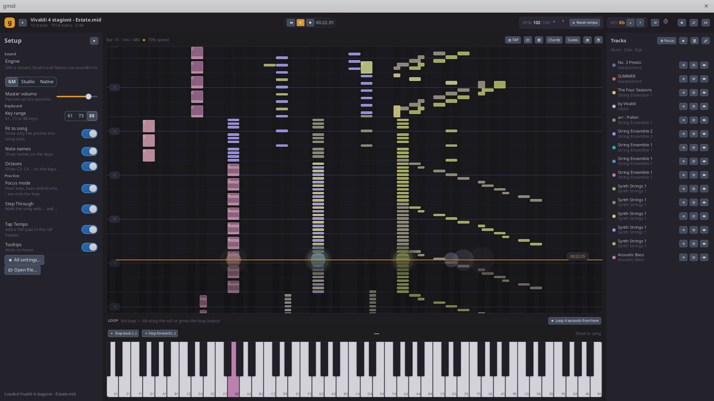
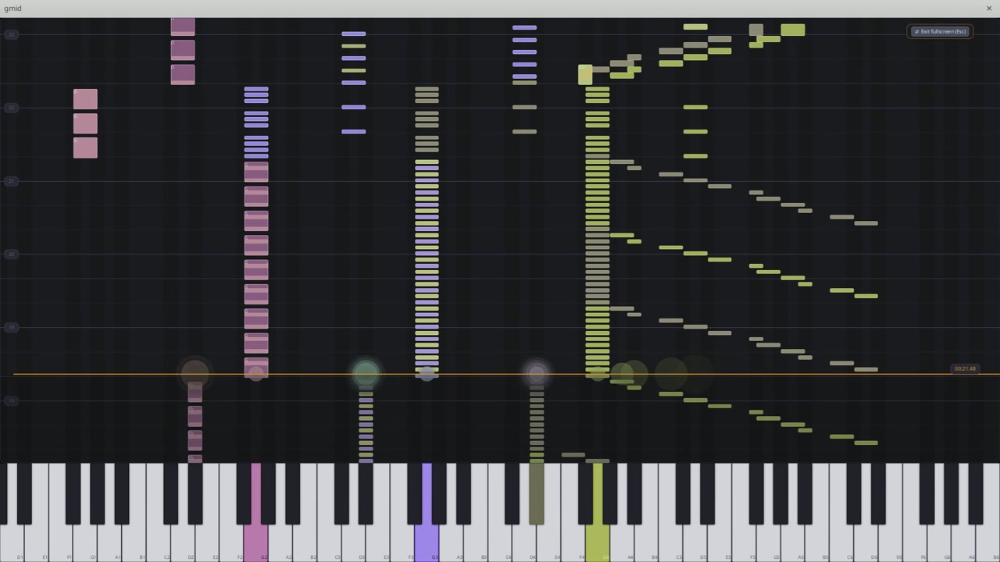

# gmid

A Go desktop rewrite inspired by [Orfeo](https://github.com/Squarebow/Orfeo):
falling-note piano roll, playable keyboard, chord and scale explorers, MIDI
editing, and a three-engine audio stack. The original Electron/React app is the
inspiration; gmid is an independent Go implementation.



Tested on macOS and Linux.

## Install

On macOS:

```sh
brew install --cask akhenakh/tap/gmid
```

The cask ad-hoc signs the bundle at install time.

Prebuilt archives for Linux and macOS (x86_64 and arm64) are attached to each
[release](https://github.com/akhenakh/gmid/releases). On Linux the archive
contains the `gmid` binary next to its `assets/` directory, which must stay
together. On macOS the archive contains only **`gmid.app`** — drag it into
`/Applications`. The bundle is unsigned, so the first launch needs
right-click → Open (or `xattr -dr com.apple.quarantine gmid.app`).

Or build from source:

```sh
make assets
make build
go run ./cmd/gmid
```

### Verifying a release

Release archives carry [build provenance](https://docs.github.com/en/actions/security-guides/using-artifact-attestations-to-establish-provenance-for-builds)
signed by this repository's release workflow:

```sh
gh attestation verify gmid_<version>_Darwin_arm64.tar.gz --repo akhenakh/gmid
```

## Demo Video

[](https://youtu.be/yJgxQjpdmHo)

[Watch the seven-minute demo on YouTube](https://youtu.be/yJgxQjpdmHo) — it
includes the onboard DecentSampler performance.

## Status

Working desktop build: MIDI/MusicXML/KAR import, realtime playback (meltysynth +
malgo), falling-note roll, playable keyboard, mixer, focus mode, metronome and
count-in, hand assignment, step-through, tap tempo, chord/scale explorers,
playback and note editors, hardware MIDI input, WAV/MP3 export and chord-chart
PDFs.

DecentSampler instruments (`*.dspreset`, `*.dslibrary`) play through a pure-Go
sampler: key/velocity zones, group and sample round robins, loop crossfades,
ADSR envelopes with DecentSampler curve shapes, key-track tuning, per-sample
delay, note/release/first/legato/continuous triggers, CC range filters,
CC-triggered zones, release-trigger decay, a global effect chain (gain,
low/high/band-pass filters, Freeverb-style reverb), and per-channel mix.
Melodic tracks use the sampler; drums keep the soundfont. Libraries are
level-matched at load (with a per-instrument gain in Settings → Audio), the
demo piano lives in `assets/decent/`, and the `gmid_decent` MCP tool loads,
unloads and inspects instruments. For a full instrument, try the free
[Steinway Grand](https://www.pianobook.co.uk/packs/steinway-grand/) pack from
Pianobook, which ships a DecentSampler version. Oscillators, buses, group
effects and the remaining effect types (delay, chorus, EQ, compressor,
convolution…) are not implemented.

A loaded DecentSampler instrument replaces the melodic synth for every
non-drum track, so the GM/Studio/Native engine only affects drums until it is
unloaded. GM uses the bundled General User GS; Studio and Native load the SF2
set in Settings → Audio (the GM bank until one is chosen). Native differs by
its exclusive low-latency output, not by its bank.

Known gaps: Guitar Pro and Capella import use the local `mscore` command when
available (not bundled); OS-level fullscreen and multi-window; per-channel VU
meters are shared with the master peak; Starmap is a static chord-star view.

## Build Requirements

- Go 1.27+
- A C compiler (cgo): Xcode command line tools on macOS; on Linux a C/C++
  toolchain and `libasound2-dev`
- `make` (optional)

`make assets` downloads the GeneralUser GS soundfont on first use; fonts, demo
songs and the DecentSampler demo instrument are committed.

Headless screenshot (no display needed):

```sh
go run ./cmd/gmid -png build/visual/shell.png -scene=shell
```

## Test and lint

```sh
go test ./...
go vet ./...
golangci-lint run
```

## MCP (drive gmid from an LLM)

`gmid` starts a Model Context Protocol server on `127.0.0.1:8765` by default:

- Streamable HTTP: `http://127.0.0.1:8765/mcp`
- SSE: `http://127.0.0.1:8765/sse`
- Disable with `-mcp=false`; change with `-mcp-addr`; add `-mcp-token` for auth.

It exposes transport, song/track inspection, mixer, note editing, library,
harmony, export, settings and screenshots. See [docs/MCP.md](docs/MCP.md).

## Audio on Linux

gmid plays through miniaudio (malgo). Settings → Audio has an **Output
backend** (Auto / Pulse / ALSA / JACK), **Buffer size** (128–1024 frames) and
an **Output device** picker. Auto follows the system — normally PipeWire via
PulseAudio; ALSA talks to the PipeWire ALSA plugin or the hardware directly.
If playback crackles, raise the buffer to 512 or 1024, then try the other
backend. `GMID_AUDIO_LOG=1` prints backend and device diagnostics.

On macOS gmid uses CoreAudio; the same buffer and device controls apply.

## License

GPL-3.0-or-later. Third-party assets and libraries are recorded in
`THIRD_PARTY_LICENSES.md`.
